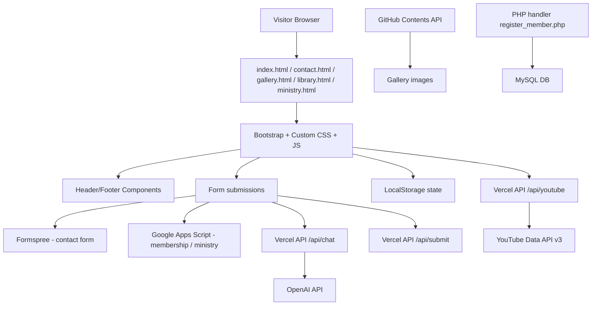
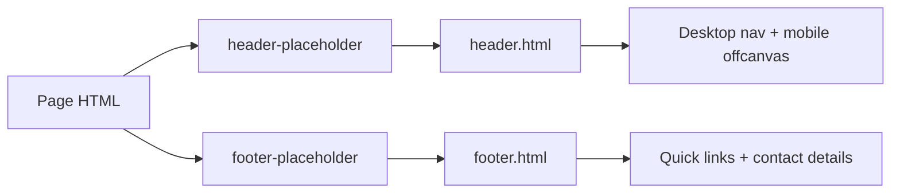
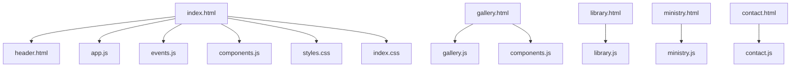

# NNP Christian Union Website Audit

## 1. Executive summary

This repository implements a static multi-page ministry website for the Nyeri National Polytechnic Christian Union (NNP CU). The application is primarily built with HTML, CSS, and vanilla JavaScript, with a small Vercel serverless layer for selected form and chatbot features. It is not a full application framework or a single-page app; it is a content-led campus ministry site with marketing pages, a gallery, a downloadable library experience, live-stream discovery, and external service integrations.

The site is in a partially implemented state. The frontend contains the main user-facing experience, while several backend or service integrations are intentionally optional or externally configured. The repository explicitly documents that some services such as Formspree, Google Apps Script, the PHP/MySQL registration handler, and live API keys are owner-managed or environment-driven, not hard-coded into the repository.

The repository is best understood as a static website plus a Vercel-backed integration layer. The architecture is intentionally lightweight and easy to host, but it depends on several external systems, many of which are not fully wired or verified in the codebase.

## 2. Repository inventory

### Root-level structure

- [index.html](../index.html) — homepage; contains the main landing page, event section, contact form, membership form, and chatbot panel.
- [contact.html](../contact.html) — contact information and message form page.
- [library.html](../library.html) — online and physical library portal with Bible lookup, dictionary, and borrowing suggestions.
- [ministry.html](../ministry.html) — ministry catalog and group registration page.
- [gallery.html](../gallery.html) — gallery landing page with GitHub-hosted image loading and video cards.
- [header.html](../header.html) — reusable header component included into pages via JavaScript.
- [footer.html](../footer.html) — reusable footer component included into pages.
- [floating-widgets.html](../floating-widgets.html) — an HTML fragment containing reusable floating chat, WhatsApp, membership modal, and lightbox markup; not clearly active in the current build.
- [styles.css](../styles.css) — primary design system and shared styling tokens.
- [index.css](../index.css) — homepage-specific styling such as floating action buttons and hero/contact styling overrides.
- [contact.css](../contact.css) — contact-page styles.
- [gallery.css](../gallery.css) — gallery layout and image-grid styling.
- [library.css](../library.css) — library page visual system.
- [ministry.css](../ministry.css) — ministry page styling.
- [header.css](../header.css) — header component styles.
- [footer.css](../footer.css) — footer component styles.
- [modernization.css](../modernization.css) — additional visual modernization layer used across pages.
- [unified style.css](../unified%20style.css) — appears to be a legacy or duplicate styling artifact; not clearly connected to the active page flow.
- [register_member.php](../register_member.php) — standalone PHP script that writes a member record to MySQL using environment variables.
- [robots.txt](../robots.txt) — crawler directives.
- [sitemap.xml](../sitemap.xml) — sitemap for search indexing.
- [favicon.png](../favicon.png) — site icon.
- [hero.jpg](../hero.jpg), [crusade.jpg](../crusade.jpg), [worship.jpg](../worship.jpg), [IMG_20251018_005801_038[1].jpg](../IMG_20251018_005801_038%5B1%5D.jpg), [kesha 2026.jpeg](../kesha%202026.jpeg), [prayer retreat .jpeg](../prayer%20retreat%20.jpeg), [image-removebg-preview (2) (1).png](../image-removebg-preview%20(2)%20(1).png), [images/](../images) — image assets used for gallery and event coverage.
- [.env.example](../.env.example) — environment variable template for required service credentials.
- [.gitignore](../.gitignore) — default ignore patterns.
- [README.md](../README.md) — repo-level summary and deployment notes.
- [UI_UX_AUDIT.md](../UI_UX_AUDIT.md) — separate UX audit document already present in the repo.
- [docs/](../docs) — operational and privacy documentation.
  - [docs/OPERATIONS.md](../docs/OPERATIONS.md) — deployment, rollback, key rotation, and backup operations.
  - [docs/PRIVACY_DRAFT.md](../docs/PRIVACY_DRAFT.md) — a privacy analysis and owner action list.
- [api/](../api) — Vercel serverless endpoints.
  - [api/chat.js](../api/chat.js) — OpenAI proxy endpoint.
  - [api/submit.js](../api/submit.js) — Google Apps Script form submission proxy for ministry enrollment.
  - [api/youtube.js](../api/youtube.js) — YouTube channel lookup for live/latest video embedding.
- [js/](../js) — browser JavaScript behaviors.
  - [js/app.js](../js/app.js) — homepage logic, chatbot, RSVP, gallery lightbox, and contact/membership workflows.
  - [js/components.js](../js/components.js) — dynamic component injection for header/footer and membership form logic.
  - [js/contact.js](../js/contact.js) — `contact.html` form submission logic.
  - [js/gallery.js](../js/gallery.js) — gallery loading, filtering, and lightbox behavior.
  - [js/library.js](../js/library.js) — library search, dictionary lookups, and borrowing suggestions.
  - [js/ministry.js](../js/ministry.js) — ministry page counters, scroll automation, and ministry registration submission.
  - [js/livestream.js](../js/livestream.js) — homepage livestream status loader.
  - [js/events.js](../js/events.js) — event data and event card rendering.

### Observed repository characteristics

- There is no `package.json`, `package-lock.json`, or build tool config in the repo root.
- There are no front-end framework or bundler files such as Vite, React, Next.js, or Vue configuration.
- The project relies on CDN-hosted CSS and JS libraries rather than local dependency installation.
- The app is served as static HTML pages, plus serverless routes in the `api/` directory for selected dynamic services.
- Some files appear to be duplicates or legacy artifacts, including `floating-widgets.html` and `unified style.css`, which are not clearly connected to the current page execution path.

## 3. Project overview

### Official project name

The repository represents the website for NNP Christian Union, a Christian student ministry at Nyeri National Polytechnic in Kenya.

### Purpose

The website exists to:

- present the ministry’s identity, mission, and values
- communicate worship, outreach, and training events
- provide connection points for new and current student members
- support prayer, contact, and general inquiries
- provide a digital library and ministry portal
- promote events and mission activities
- collect submissions for contact, membership, and ministry enrollment

### Intended users

The site is designed for:

- prospective students interested in joining the fellowship
- existing members seeking ministry opportunities
- parents or supporters looking for contact information
- ministry leaders managing enrollment and outreach
- visitors seeking sermons, resources, or event information

### Main objectives

- build a credible campus-ministry web presence
- improve discoverability via search engines and social metadata
- centralize ministry information and events
- allow simple data collection via forms and external services
- provide a lightweight, static publishing workflow suitable for Vercel

### Current development status

The repository appears to be an active but partially completed site. It includes polished front-end design, multiple static pages, and several integrations, but several operational and configuration items remain owner-managed. Some features are implemented, partially implemented, or intentionally disabled until the owner provides verified service details.

## 4. Technology stack

### Core web technologies

1. HTML5
   - Used throughout the project for page structure.
   - Verified in all page files such as [index.html](../index.html), [contact.html](../contact.html), [gallery.html](../gallery.html), [library.html](../library.html), and [ministry.html](../ministry.html).
   - Purpose: semantic document structure, form markup, content sections, and page-level layout.

2. CSS3
   - Used through [styles.css](../styles.css) and page-specific CSS files.
   - Purpose: design system, spacing, typography, color tokens, components, responsive layout.

3. Vanilla JavaScript (ES2019+ style)
   - Used in all browser behaviors.
   - Purpose: document rendering, event handling, dynamic content loading, form submission, local storage state, and API requests.
   - Important files: [js/app.js](../js/app.js), [js/components.js](../js/components.js), [js/gallery.js](../js/gallery.js), [js/library.js](../js/library.js), [js/ministry.js](../js/ministry.js).

### Frontend libraries and frameworks

1. Bootstrap 5.3.3
   - Included from jsDelivr in the HTML headers.
   - Purpose: layouts, grid system, modal, offcanvas, buttons, forms, and general UI components.
   - Verified in [index.html](../index.html), [header.html](../header.html), [contact.html](../contact.html), [gallery.html](../gallery.html), and [library.html](../library.html).

2. Font Awesome 6.4.0 / 6.5.0
   - Used for icons in navigation, hero elements, buttons, and page-specific icons.
   - Purpose: interface decoration and simple iconography.

3. AOS (Animate On Scroll)
   - Included from `cdnjs` and `unpkg` in multiple pages (`aos@2.3.1` and `aos@2.3.4`).
   - Purpose: scroll-triggered animations.

4. Google Fonts
   - `Inter` and `Roboto` are loaded from Google Fonts.
   - Purpose: branded typography and better type hierarchy.

### Hosting and deployment

1. Vercel
   - The repository is described as deploying via the Vercel project workflow in [README.md](../README.md) and [docs/OPERATIONS.md](../docs/OPERATIONS.md).
   - Purpose: static hosting plus serverless route execution for `/api/chat`, `/api/submit`, and `/api/youtube`.

2. PHP
   - Used by [register_member.php](../register_member.php) for database-backed registration.
   - Purpose: legacy or standalone member registration handler requiring a separately configured PHP host.

3. MySQL-compatible database
   - Required by the PHP registration flow; environment names are `DB_HOST`, `DB_USER`, `DB_PASS`, and `DB_NAME`.
   - Purpose: member data persistence when the standalone PHP handler is deployed.

### External services and APIs

1. OpenAI API
   - Used by [api/chat.js](../api/chat.js).
   - Purpose: AI response generation for the website chatbot.
   - Requires `OPENAI_API_KEY` in the environment.

2. YouTube Data API v3
   - Used by [api/youtube.js](../api/youtube.js).
   - Purpose: queries the `@nnpcumedia` channel for a live stream or latest embeddable upload.
   - Requires `YOUTUBE_API_KEY` in the environment.

3. Google Apps Script
   - Referenced in [js/components.js](../js/components.js) and [README.md](../README.md).
   - Purpose: membership form and ministry enrollment service endpoint.
   - The script URLs are hard-coded to Google Apps Script executions and are owner-managed.

4. Formspree
   - Used in [contact.html](../contact.html) and [README.md](../README.md).
   - Purpose: contact form submissions.

5. GitHub repository contents API
   - Used by [js/gallery.js](../js/gallery.js) to fetch image files from the `images/gallary` folder in the GitHub repo.
   - Purpose: dynamic gallery loading without storing all images in a database.

6. Bible API
   - Referenced in [js/app.js](../js/app.js) and [js/library.js](../js/library.js).
   - Purpose: verse lookup and scripture discovery using public Bible API endpoints.

## 5. System architecture

### 5.1 High-level architecture



### 5.2 Navigation architecture

The site does not use a SPA router. Pages are static and linked directly by anchors and direct HTML links. The reusable navigation is injected with [js/components.js](../js/components.js), which loads [header.html](../header.html) and [footer.html](../footer.html) into placeholder elements.



### 5.3 Data-flow architecture

- Contact form: browser `fetch` to Formspree form endpoint, with user message and metadata.
- Membership form: browser `fetch` to Google Apps Script endpoint with full name, student ID, email, phone, and year/class.
- Ministry enrollment: browser `POST` to `/api/submit`, which forwards to Google Apps Script; the API validates the request and returns a status payload.
- AI chatbot: browser `POST` to `/api/chat`, which validates the payload, rate-limits requests, and forwards to the OpenAI Chat Completions endpoint.
- livestream: browser `GET /api/youtube`, which calls the YouTube Data API and returns a live or latest embeddable video.
- Gallery: browser calls the GitHub Contents API and renders images using fetched metadata.

### 5.4 Component relationship diagram



## 6. Complete page-by-page documentation

### 6.1 Homepage: [index.html](../index.html)

Purpose:
- main entry page for the campus ministry
- communicates position, mission, values, and event awareness
- hosts homepage contact and membership flows
- exposes the webpage’s livestream and chatbot interface

Key sections:
- hero banner with statement “Where Everybody Is Somebody, And Jesus Christ Is Lord”
- about/vision/mission section
- event cards
- live stream section
- call to action sections
- membership and contact forms
- floating action buttons for chat and WhatsApp

Interactive behavior:
- [js/app.js](../js/app.js) handles smooth scrolling, RSVP, lightbox, chat logic, and contact/membership actions.
- [js/events.js](../js/events.js) builds event cards from a static events array.
- [js/livestream.js](../js/livestream.js) loads and refreshes the latest YouTube stream.

Forms and data submission:
- homepage contact form is present in [index.html](../index.html) and is submitted via Formspree.
- homepage membership form is loaded by [header.html](../header.html) and wired in [js/components.js](../js/components.js).

### 6.2 Contact page: [contact.html](../contact.html)

Purpose:
- provide official contact details and a prayer/support contact form

Page features:
- location card
- phone and email cards
- “Prayer & Support” card
- contact form with subject selection
- success/error status feedback handled by [js/contact.js](../js/contact.js)

Important implementation notes:
- Form action points to Formspree: `https://formspree.io/f/mpwodeko`.
- The page uses `formspree.io` and `fetch(form.action, { method: form.method || "POST", body: new FormData(form), headers: { Accept: "application/json" } })`.
- Several owner-supplied contact values are placeholders or TODOs, especially the general contact email and social links.

### 6.3 Gallery page: [gallery.html](../gallery.html)

Purpose:
- show ministry moments, worship images, mission photos, and event albums
- present a filtering gallery and embedded video list

Key features:
- hero header with “Moments of Faith”
- gallery category filters for worship, outreach, prayer retreat, fellowship, events, and mission
- live image loading from GitHub repository via the GitHub Contents API
- lightbox viewer for selected images
- embedded YouTube videos for “Latest Sermons”

Implementation details:
- [js/gallery.js](../js/gallery.js) fetches `https://api.github.com/repos/muregavictor-dev/NNP-C-U/contents/images/gallary`.
- It filters `.jpg`, `.jpeg`, `.png`, and `.webp` files and maps them into gallery items.
- Category detection is based on filename strings, not a structured metadata file.

### 6.4 Library page: [library.html](../library.html)

Purpose:
- provide a local digital library and basic Bible dictionary experience for students
- enable “Borrow” request preparation for physical books

Features:
- global search form for “book, Bible verse, or topic”
- quick cards for Bible lookup, suggestion, and dictionary tools
- physical catalogue of books with borrow buttons
- modal form for borrowing request details
- local dictionary of Christian terms
- Bible verse lookup via the public Bible API

Important implementation notes:
- `LIBRARY_BORROW_ENDPOINT` and `BOOK_SUGGESTION_ENDPOINT` are set to `null` in [js/library.js](../js/library.js), which means these features do not transmit data unless configured by the owner.
- Borrow and suggestion flows are not fully connected to a real endpoint.
- Search falls back to the local HTML catalogue when the query is not a Bible verse and does not match the library content.

### 6.5 Ministry page: [ministry.html](../ministry.html)

Purpose:
- present ministry and small-group options
- advertise the different teams, leaders, and meeting times
- enable group enrollment

Features:
- animated counters for ministry stats
- cards for praise and worship, Bible study, missions, hospitality, and other teams
- group registration form for ministry selection
- smooth scroll behavior and AOS animations

Implementation details:
- [js/ministry.js](../js/ministry.js) handles scroll progress, counters, and the ministry submission flow.
- The `ministryEmails` object is present but all values are `null`; the page displays a target contact only if a real email is later supplied.
- The form posts JSON to `/api/submit` and expects a `result.success === true` response.

### 6.6 Shared header: [header.html](../header.html)

Purpose:
- provides consistent navigation and membership CTA on all pages
- accounts for both desktop navigation and mobile menu drawer

Key elements:
- brand identity and tagline
- nav links to Home, Library, Ministries, Live, Gallery, Contact
- notification menu button
- “Become a Member” CTA
- offcanvas mobile nav
- membership modal form

### 6.7 Shared footer: [footer.html](../footer.html)

Purpose:
- common footer information with quick links, contact support, and optional social media links

Important notes:
- social icons are intentionally hidden and marked as TODOs by the owner.
- footer contains a portfolio link to the developer’s site.
- contact details are partially populated and require verification.

### 6.8 Floating widgets fragment: [floating-widgets.html](../floating-widgets.html)

Purpose:
- a reusable HTML fragment containing a WhatsApp button, chat button, notification panel, and lightbox wrappers

Status:
- not clearly active in the current page flow
- appears to be a design prototype or partial pattern library rather than the active runtime implementation

## 7. Feature documentation

### 7.1 Membership modal and member signup flow

- Trigger: button in shared header or homepage hero actions.
- Browser logic: `bindMembershipForm` in [js/components.js](../js/components.js).
- Data payload: `fullName`, `studentID`, `email`, `phone`, `yearClass`.
- Service: Google Apps Script endpoint, hard-coded in [js/components.js](../js/components.js).
- Response handling: success alert with `result.message` or error alert.
- Current status: implemented but externally dependent; no local fallback exists.

### 7.2 AI chatbot

- Trigger: floating chat button and chat widget on the homepage.
- Browser logic: `fetchOpenAIResponse` and `isBibleQuestion` in [js/app.js](../js/app.js).
- Server-side endpoint: [api/chat.js](../api/chat.js).
- Data flow: browser POSTs `{ message, context }` to `/api/chat`; the route validates payload size, rate limits, matches environment key, and calls the OpenAI API.
- Behavior: a concise assistant responds about ministry activities and Christian topics.
- Current status: functional when `OPENAI_API_KEY` is set in the Vercel environment.

### 7.3 Live stream widget

- Trigger: homepage “Live” section and/or “Join Live Worship” call to action.
- Logic: [js/livestream.js](../js/livestream.js).
- Backend endpoint: [api/youtube.js](../api/youtube.js).
- Behavior: call the YouTube Data API, discover a live stream or latest public embeddable video, and display it in an iframe.
- Cache behavior: `RESPONSE_CACHE_SECONDS = 1200` indicates a 20-minute cache window.
- Current status: depends on `YOUTUBE_API_KEY` and the owner-managed `@nnpcumedia` channel.

### 7.4 RSVP flow

- Logic: `initRsvpButtons` in [js/app.js](../js/app.js).
- Data: event ID and title.
- Behavior: if `RSVP_ENDPOINT` is set, it posts to that service; otherwise, the event is saved to `localStorage` under `nnp-rsvp-list`.
- Current status: local-only by default; external service remains unconfigured.

### 7.5 Gallery loading and lightbox

- Logic: [js/gallery.js](../js/gallery.js).
- Data source: GitHub repository contents under `images/gallary`.
- Behavior: downloads metadata, filters by category, renders cards, and opens an image in a lightbox.
- Current status: implemented and functional provided GitHub file listing remains available.

### 7.6 Library search and Bible lookup

- Logic: [js/library.js](../js/library.js).
- Behavior: when the search query matches a Bible citation such as `John 3:16`, it calls the public Bible API; otherwise it searches the local HTML catalogue.
- Current status: implemented as a front-end-only library tool; no persistent backend or storage layer.

### 7.7 Ministry registration workflow

- Logic: [js/ministry.js](../js/ministry.js).
- Request: JSON payload with `name`, `regNumber`, `phone`, and `group`.
- Server: [api/submit.js](../api/submit.js).
- Service endpoint: hard-coded Google Apps Script URL.
- Response handling: success message shown if `result.success === true`.
- Current status: implemented but not owner-verified in the repo.

### 7.8 Contact form workflow

- Logic: [js/contact.js](../js/contact.js).
- Form endpoint: `form.action` in [contact.html](../contact.html), pointing to Formspree.
- Behavior: validates HTML form fields, then sends `FormData` as a POST with `Accept: application/json`.
- Current status: implemented and ready once the correct Formspree endpoint is maintained.

## 8. JavaScript and application logic

### JavaScript file responsibilities

#### [js/components.js](../js/components.js)

This file is central to the design system’s shared chrome. It:

- loads the header/footer into placeholders
- injects the notification panel and membership modal into the DOM tree
- binds navbar scroll effects
- tracks active nav state
- handles notification read status in localStorage
- binds the membership form submission to a Google Apps Script endpoint

Key functions:
- `loadComponent()`
- `bindHeaderScrollEffect()`
- `bindHeaderNavigation()`
- `addHeaderOverlays()`
- `bindNotificationActions()`
- `bindMembershipForm()`
- `setActiveNavigation()`

#### [js/app.js](../js/app.js)

This file contains the home page interaction layer.

Major responsibilities:
- fast DOM caching through the `DOM` object
- Bible API interaction (`fetchBibleVerse`, `checkRateLimit`, `isBibleQuestion`)
- smooth-scroll behavior for in-page anchors
- RSVP storage or external send logic
- gallery lightbox and page-level interactions
- contact form and membership form submission handlers
- chatbot request orchestration
- localStorage handling for chat history and notifications

Important logic:
- `fetchOpenAIResponse(userMessage, context = '')` calls `/api/chat`.
- `initRsvpButtons()` saves event IDs locally when no service endpoint exists.
- `showToast()` (noted in comments but not fully visible in earlier snippets) centralizes status messaging.

#### [js/gallery.js](../js/gallery.js)

Responsibilities:
- fetches image metadata from the GitHub repo
- filters images by filename keyword categories
- renders responsive gallery cards
- controls the lightbox navigation and keyboard interactions
- renders embedded video thumbnails for sermon content

Key logic:
- `getCategory(filename)`
- `renderGallery()`
- `openLightbox(index)`
- `showAdjacentImage(direction)`
- `loadImages()`

#### [js/library.js](../js/library.js)

Responsibilities:
- search form success/failure messaging
- Bible verse lookup calls to `https://bible-api.com/...`
- local dictionary and insight generation
- suggestion and borrowing request preparation
- scroll-to-section behavior from “Quick Access” cards

Key logic:
- `scrollToField(cardId, inputId)`
- `showMessage(target, text, className = "")`
- `renderBibleVerses(target, verses)`
- `fetchBibleVerse(query, target)`

#### [js/ministry.js](../js/ministry.js)

Responsibilities:
- animated stat counters for ministry counts
- smooth scrolling on anchor navigation
- ministry enrollment form validation and submission
- success/error UI handling

Key logic:
- `showRegistrationError(message)`
- async submission listener tied to `registrationForm`
- fetch to `/api/submit`

#### [js/contact.js](../js/contact.js)

Responsibilities:
- intercept the contact form submission
- call `fetch(form.action, { ...FormData })`
- display success or failure message box visible on the page

#### [js/livestream.js](../js/livestream.js)

Responsibilities:
- fetch `/api/youtube`
- populate the YouTube iframe
- show a live-now or latest-video status
- refresh periodically every 20 minutes

### State handling and storage

The app uses the browser’s `localStorage` for a few features:

- `nnp-notifications-read` — tracks whether the notification panel was marked as read.
- `nnp-rsvp-list` — saves RSVP event IDs when no external endpoint is configured.
- `nnp-chat-history` — stores prior messages in the chatbot.
- `nnp-chat-analytics` — appears to be prepared for future analysis but is not clearly used in the active runtime.

These behaviors are referenced in [js/app.js](../js/app.js).

## 9. CSS and design system

### Global styling architecture

The repository defines a design token layer in [styles.css](../styles.css). The key theme is a Christian campus brand identity using a green/gold palette and a modern corporate structure.

Color system:
- `--primary-green: #2F8A4B`
- `--deep-green: #185A35`
- `--warm-gold: #E8B83D`
- `--muted-yellow: #F6DEA0`
- neutrals for greys, whites, and text colors

Typography:
- `Inter` for headings and display text
- `Roboto` for body copy
- consistent CSS variables for sizes and type hierarchy

Layout rules:
- container widths are controlled with Bootstrap and custom `--container-max`
- `html { scroll-behavior: smooth; }`
- global spacing variables (`--space-*`) control rhythm
- cards, buttons, and surfaces share a common shape and shadow system

### Component patterns

- buttons with `.btn-gold`, `.btn-primary-green`, and standard Bootstrap classes
- cards with consistent border radius and subtle shadow
- callout boxes and hero overlays
- dark green header navigation and gold CTA buttons
- responsive grid-based page sections

### Additional styling files

- [index.css](../index.css): floating action buttons, homepage-only overrides, contact form panel styling.
- [contact.css](../contact.css): specific card styles and contact page layout.
- [gallery.css](../gallery.css): gallery cards, lightbox, filter buttons, responsive image layout.
- [library.css](../library.css): search cards, catalogue cards, and forms.
- [ministry.css](../ministry.css): ministry cards, progress bar, and stat counters.
- [header.css](../header.css): header-specific styling.
- [footer.css](../footer.css): footer-specific styling.
- [modernization.css](../modernization.css): general modernization overrides and cross-page consistency layer.

### Design observations

- This is a highly styled static front-end with a consistent brand palette.
- Several pages reference multiple CSS sources; some overlap is visible between `styles.css`, `modernization.css`, and page-specific CSS files.
- The repository appears to mix older CSS conventions and newer component-driven styling. This is not necessarily a defect, but it indicates a partially evolving design system.
- Some duplicate or legacy files, including `unified style.css`, suggest a historical design evolution and potential cleanup opportunity.

## 10. Database and backend documentation

### 10.1 Backend architecture

The site’s backend is lightweight and split across a few channels:

- static HTML delivery via Vercel or any static host
- serverless routes under [api/](../api)
- a standalone PHP handler at [register_member.php](../register_member.php)
- external services hosted outside the repo (Google Apps Script, Formspree, OpenAI, YouTube)

### 10.2 Serverless routes

#### /api/chat

- File: [api/chat.js](../api/chat.js)
- Method: POST
- Validates request method, content type, payload size, message length, and rate limits.
- Reads `OPENAI_API_KEY` from environment variables.
- Sends a chat completion request to `https://api.openai.com/v1/chat/completions`.
- Returns `200` with `{ text }` or a failure response.

#### /api/submit

- File: [api/submit.js](../api/submit.js)
- Method: POST
- Validates request object and forwards to a Google Apps Script endpoint.
- Returns a success/failure payload to the browser.
- No database or local storage is used inside this route itself.

#### /api/youtube

- File: [api/youtube.js](../api/youtube.js)
- Method: GET
- Reads `YOUTUBE_API_KEY` from environment variables.
- Resolves the `@nnpcumedia` channel and retrieves either a live stream or latest embeddable upload.
- Sets `Cache-Control` response headers to reduce repeated API use.

### 10.3 PHP/MySQL registration handler

- File: [register_member.php](../register_member.php)
- Logic: reads `DB_HOST`, `DB_USER`, `DB_PASS`, `DB_NAME` from the environment, opens a MySQL connection, validates required form fields, and inserts a record into a `members` table.
- SQL statement:

```sql
INSERT INTO members (studentID, fullName, email, phone, yearClass, groupsOfInterest, testimony)
VALUES (?, ?, ?, ?, ?, ?, ?)
```

Important caveat:
- The repository does not include the actual schema or migrations. The database table definition is therefore not verifiable from the source alone.
- The file is a standalone PHP script and not connected to the static frontend by direct page references from the HTML files inspected in this repo.

### 10.4 External data storage and service ownership

The repository explicitly states that the owner must confirm ownership and retention rules for several services:

- Formspree contact submissions
- Google Sheets/Apps Script destinations
- MySQL database backups and restore procedures
- any owner-managed service or spreadsheet for enrollment or member records

This is documented in [docs/OPERATIONS.md](../docs/OPERATIONS.md).

## 11. Functional and operational risks

This repository is useful and operationally light, but it carries known constraints and risks:

1. External services are partially configured rather than fully integrated.
2. Several contact values are placeholders or TODOs.
3. No package manager or automated test suite is present in the repo.
4. The app is a static site with a very thin integration layer; it is not self-contained for all major features.
5. Some features rely on browser localStorage instead of a real backend, which means they are not durable or shareable across devices.
6. Hard-coded Google Apps Script URLs and external API endpoints create ownership and change-management overhead.
7. The live stream and chatbot paths depend on environment variables that must be correctly set in Vercel.
8. The account-level secret keys and database credentials are intentionally kept out of repo files, but they are critical to production operations.

## 12. Architectural conclusions

The project is best categorized as a static ministry website with owner-managed backend integrations. It is intentionally lightweight and practical for a small organization, but it is not a complete self-hosted application. The architecture is intentionally simple: HTML + CSS + JS in the browser, with a handful of Vercel functions and external services handling dynamic actions.

The site’s strengths are:

- clear mission and communications strategy
- strong visual identity and page coverage
- clear front-end behavior for ministry outreach
- external integrations that reduce the need for a complex backend

Its weaknesses are:

- partial integration ownership
- missing environment configuration and external verification
- several TODOs for owner-controlled data destinations
- no in-repo database schema or testing workflow
- some pages or fragments appear to be legacy or partially disconnected from active runtime use

## 13. Final assessment

The repository is a well-structured static website for a campus Christian union, with a clear branding strategy and a functional multi-page layout. The code is readable, the visual system is consistent, and the main site pages are present. However, the application is only “fully operational” when the owner configures and manages the external data destinations and environment variables. The site’s true runtime depends heavily on external services and operational ownership rather than the repository alone.

This is a documentation package produced from the actual repository contents, not from assumptions or fabrications. Where the repo is incomplete, the documentation marks that clearly.
